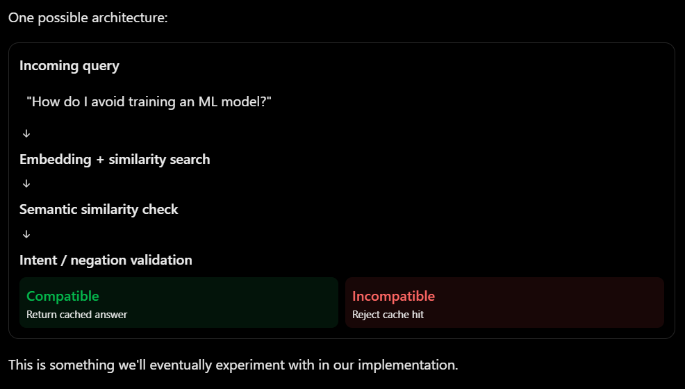

# ERR — Technical Documentation

## 1. Project Overview

ERR is an air-quality intelligence project focused on monitoring air quality across India and forecasting pollutant concentrations for the next 72 hours.

Initial forecasting targets:
- PM2.5
- PM10

The project uses historical air-quality measurements, live observations and weather information to develop forecasting models.

---

## 2. Development Environment

- Language: Python 3.13
- IDE: Visual Studio Code
- Environment: Python virtual environment (`.venv`)
- API: XKDR India Air Quality Database
- HTTP library: Requests
- Environment variable management: python-dotenv

### Dependencies

- requests
- python-dotenv
- duckdb==2.0.1

---

## 3. Data Source: XKDR

Base URL:

`https://airquality.xkdr.org`

Authentication: Bearer token.

### 3.1 Metadata Inspection

Script: `src/ingestion/inspect_xkdr.py`

Endpoint:
`GET /v1/meta`

Purpose:
- Inspect dataset coverage.
- Retrieve export timestamp.
- Inspect measurement count.
- Identify available stations and parameters.
- Verify API access tier and query limits.

### 3.2 Station Inspection

Script: `src/ingestion/inspect_stations.py`

Endpoint:
`GET /v1/stations`

Parameters:
- `city=Mumbai`

Purpose:
- Retrieve Mumbai monitoring stations.
- Inspect station IDs and names.
- Retrieve geographic coordinates.
- Examine first and last recorded observations.
- Identify available pollutants.

### 3.3 Measurement Inspection

Script: `src/ingestion/inspect_measurements.py`

Endpoint:
`GET /v1/measurements`

Query configuration:
- Station: `site_5106`
- Pollutants: PM2.5, PM10
- Start: 2025-08-24
- End: 2025-08-30
- Aggregation: Hourly

Purpose:
- Retrieve historical pollutant measurements.
- Inspect response structure.
- Examine concentration values and units.
- Calculate hourly data completeness.
- Identify missing timestamps.

### 3.4 Data Completeness Method

Expected hourly timestamps are generated for the requested period.

Actual timestamps are extracted from the API response.

Missing timestamps are calculated using set difference:

`Missing = Expected timestamps - Actual timestamps`

Missing observations are classified as:
- Internal gaps: Missing timestamps before or at the last observed timestamp.
- Trailing gaps: Missing timestamps after the last observed timestamp.

Coverage:

`Coverage (%) = (Observed hours / Expected hours) × 100`

### 3.5 Multi-Station Data-Quality Comparison

Script: `src/ingestion/compare_station_quality.py`

Endpoint:
`GET /v1/measurements`

Query configuration:
- Stations (repeated `station` parameter):
  - `site_5106` (Vile Parle West)
  - `site_5399` (Chakala–Andheri East)
  - `site_5102` (Malad West)
- Pollutants (repeated `parameter` parameter): `PM2.5`, `PM10`
- Start: `2025-08-24`
- End: `2025-08-30`
- Aggregation: `hourly`

Metrics computed per station and pollutant:
- Unique observed hourly timestamps vs. expected hourly timestamps (168 hours)
- Duplicate timestamp count (raw records minus unique timestamps, reported without silent removal)
- Total missing timestamps, internal gaps (`<= last_observed`), and trailing gaps (`> last_observed`)
- Coverage percentage
- Average pollutant concentration (`mean` across non-null observations; missing readings are never treated as zero or imputed)
- First and last observed timestamps

Methodology:
- All expected hourly timestamps from `2025-08-24 00:00` through `2025-08-30 23:00` (168 hours) are generated.
- API rows are grouped by `(station_id, parameter_name)` without modifying or imputing missing values.
- Empty station/pollutant combinations are handled gracefully (`0/168`, `0.00%` coverage, `N/A` average concentration and timestamps).

### 3.6 Historical Data-Quality Stability Comparison

Script: `src/ingestion/compare_historical_quality.py`

Endpoint:
`GET /v1/measurements`

Query configuration:
- Stations (repeated `station` parameter):
  - `site_5106` (Vile Parle West)
  - `site_5399` (Chakala–Andheri East)
  - `site_5102` (Malad West)
- Pollutants (repeated `parameter` parameter): `PM2.5`, `PM10`
- Aggregation: `hourly`
- Four seven-day 2024 windows (`168` expected hours per window):
  - Winter: `2024-01-15` to `2024-01-21`
  - Summer / Pre-Monsoon: `2024-04-15` to `2024-04-21`
  - Southwest Monsoon: `2024-08-24` to `2024-08-30`
  - Post-Monsoon: `2024-11-11` to `2024-11-17`

Methodology and metrics:
- Reuses `compare_station_quality.py` configuration, timestamp generation, and per-station/pollutant completeness analysis.
- Evaluates each `(season, station, pollutant)` combination independently (`24` combinations total).
- Verifies that `meta.timezone` reports naive IST for `cpcb_caaqm` rows and checks that parsed timestamps carry no timezone offset (`tzinfo is None`).
- Checks both `X-Truncated` headers and `meta.truncated` to ensure truncated responses are never silently treated as complete.
- Computes expected hours (`168`), raw records, unique timestamps, duplicate timestamps, missing timestamps, internal gaps, trailing gaps, coverage percentage, average concentration from valid numeric `mean` values (without zero-filling or imputation), and first/last observed timestamps.
- Outputs a grouped comparison table and a four-window station coverage summary, keeping data availability distinct from sensor accuracy.

### 3.7 Single-Month DuckDB Remote Parquet Validation

Script: `src/ingestion/validate_duckdb_month.py`

Target file:
`GET /v1/files/v1/measurements/year=2024/month=08/data.parquet`

How remote querying works:
- XKDR's `/v1/files/<key>` endpoint serves Apache Parquet files and supports HTTP `Range` requests (`Accept-Ranges: bytes`).
- DuckDB's `httpfs` extension reads the Parquet file footer first and fetches only the byte ranges required for the projected columns (`station_id`, `parameter_name`, `collected_at`, `value`) and filtered rows, avoiding a full-file download.
- Authentication is configured in DuckDB via `CREATE SECRET` with `TYPE HTTP` and an `Authorization: Bearer <XKDR_API_KEY>` header scoped to `https://airquality.xkdr.org/v1/files/`.

Validation checks performed:
- **Raw timestamp cadence:** Counts raw rows, null values, duplicate timestamps, unique hours, observations per hour (`min`–`max`), and time deltas between consecutive observations (`min`/`median`/`max` minutes) across all `744` hours of August 2024.
- **Boundary-aware gap analysis:** Distinguishes leading missing hours (before `first_observation`), internal missing hours, trailing missing hours (after `last_observation`), and longest consecutive missing-hour streak; empty station/pollutant series are reported explicitly as `EMPTY(744)` without false leading/internal/trailing splits.
- **Baseline reproduction:** Re-aggregates `2024-08-24` to `2024-08-30` (`168` hours) and compares observed hour counts and mean concentrations against the verified `/v1/measurements?agg=hourly` baseline.

### 3.8 2024 Annual Historical Data-Quality Pilot

Script: `src/ingestion/analyze_duckdb_2024.py`

Data source:
- Discovers all 12 monthly 2024 Parquet partitions (`v1/measurements/year=2024/month=01..12/data.parquet`) dynamically via `GET /v1/files`.
- Queries each partition remotely via DuckDB `httpfs` with `Authorization: Bearer <XKDR_API_KEY>` (`CREATE SECRET`), projecting only `station_id`, `parameter_name`, `collected_at`, and `value` for `site_5106`, `site_5399`, and `site_5102` (`PM2.5`, `PM10`).

Methodology and safeguards:
- Verifies `collected_at` timestamps are naive IST (`tzinfo is None`) and filters months using half-open intervals (`start <= ts < end_exclusive`).
- Tracks `raw_records`, `valid_records`, `null_records`, `unique_timestamps`, `duplicate_timestamps`, `unique_raw_hours`, and `unique_valid_hours` separately so `NULL`-only hours are never counted as valid observed hours.
- Checks reporting cadence (`min`/`max` observations per hour and `min`/`median`/`max` consecutive intervals) per month without assuming hourly cadence.
- Classifies each station–pollutant–month as `no_records`, `null_only`, `active_partial`, or `active_complete` (never inferring a full station outage from missing PM2.5/PM10 records, and keeping availability separate from measurement accuracy).
- Reconciles August 2024 (`2024-08`) against `validate_duckdb_month.py` and the `2024-08-24`–`2024-08-30` API baseline.
- Saves reproducible outputs to `data/processed/duckdb_2024_pilot/monthly_metrics_2024.csv` and `data/processed/duckdb_2024_pilot/summary_2024.json`.

### 3.9 Full Historical Continuity Analysis (June 2019–November 2026)

Script: `src/ingestion/analyze_duckdb_full_history.py`

Scope:
- Dynamically verifies all `90` expected calendar months (`2019-06` through `2026-11`, `65,760` calendar hours; note that `2026-11` is a partial month with `exported_at = 2026-11-24T06:54:03+00:00`, leaving `65,605` calendar hours up to export and `155` post-export hours) against `/v1/files`.
- Queries each monthly Parquet partition remotely via DuckDB `httpfs` (`site_5106`, `site_5399`, `site_5102`; `PM2.5`, `PM10`).

Resumability and cross-month methodology:
- Saves per-month checkpoints (`data/processed/duckdb_full_history/checkpoints/<YYYY-MM>.json`) and updates `processing_manifest.json` after every month (`ok`, `failed`, or `unavailable`) so interrupted runs resume cleanly without duplicating rows or silently skipping failures.
- Computes cross-month consecutive missing-hour gaps across the continuous `2019-06-01 00:00`–`2026-11-30 23:00` timeline, reporting both full-window longest gaps and active-period internal longest gaps (`first_observed_hour` to `last_observed_hour`).
- Keeps full-window availability, confirmed active-period availability, zero-record months, and unknown operational status distinct, without treating missing values as zero or equating availability with sensor accuracy.
- Validates the 2024 subset (`72` rows) against `data/processed/duckdb_2024_pilot/monthly_metrics_2024.csv`.
- Saves reproducible outputs under `data/processed/duckdb_full_history/` (`monthly_metrics.csv`, `historical_gaps.csv`, `station_pollutant_summary.csv`, `processing_manifest.json`, `summary.json`).

### 3.10 Measurement Quality & Anomaly Screening

Script: `src/preprocessing/screen_measurement_quality.py`

Input:
- Queries the `88` non-empty monthly partitions identified in `data/processed/duckdb_full_history/processing_manifest.json` via DuckDB `httpfs` (`234,645` rows total) and caches the extracted subset locally at `data/processed/measurement_quality/filtered_measurements_2019_2026.parquet` without modifying raw or ingestion outputs.

Methods and assumptions:
- **Basic distribution screening:** Computes counts (`total`, `null`, `negative`, `zero`, `unique`), mean, median, standard deviation, and `P1/P5/P25/P75/P95/P99` percentiles per station and pollutant.
- **Extreme-value & step-change screening:** Flags `value < 0` as confirmed invalid; computes upper `1.5×IQR` and `3.0×IQR` fences, MAD-based robust Z-scores (`|0.6745 * (x - median) / MAD| > 3.5`), and consecutive 1-hour step spikes/drops (`|delta_1h|` exceeding `max(Q3 + 3×IQR, median + 5×MAD)` of `|delta_1h|`, computed only across adjacent 1-hour timestamps so multi-hour gaps are never treated as 1-hour jumps). Statistical extremity alone is never treated as proof of sensor error.
- **Flatline screening:** Identifies consecutive 1-hour runs of identical values (`>= 2h`), distinguishing ordinary short repeats (`2–3h`) from unusually long flatlines (`>= 4h`).
- **Temporal screening:** Aggregates `count`, `zero_count`, `mean`, `median`, and `P95` by `hour_of_day`, `day_of_week`, `season`, `year`, and `year_month`, keeping missing periods separate from `0.0` readings.
- Saves outputs under `data/processed/measurement_quality/` (`measurement_summary.csv`, `anomaly_flags.csv`, `flatline_summary.csv`, `temporal_summary.csv`, `quality_report.json`) without removing or imputing any values.

### 3.11 Targeted Measurement Anomaly Verification & QA Policy

Script: `src/preprocessing/investigate_anomalies.py`

Input:
- `data/processed/measurement_quality/filtered_measurements_2019_2026.parquet` (read-only).

Methodology:
- Cross-checks five flagged anomaly cases (A–E) against co-located pollutants (`PM2.5` vs. `PM10`) and overlapping neighbouring stations (`site_5106`, `site_5399`, `site_5102`).
- Classifies findings into `Confirmed invalid`, `Strongly suspicious`, `Requires further investigation`, or `Plausible environmental event`, and defines a non-destructive QA policy (`qa_policy.json`) that masks strongly suspicious targets during model training while retaining raw measurements with QA flags.
- Saves `targeted_anomaly_investigation.csv`, `qa_policy.json`, and `investigation_report.md` under `data/processed/measurement_quality/`.

### 3.12 Historical Weather Validation Pilot (Open-Meteo ERA5)

Script: `src/ingestion/validate_weather_pilot.py`

Configuration:
- Provider & Endpoint: Open-Meteo Historical Weather API (`https://archive-api.open-meteo.com/v1/archive`)
- Model: `era5` (selected over `era5_land` because `era5_land` returned nulls for `wind_speed_10m`, `wind_direction_10m`, `precipitation`, `surface_pressure`, and `cloud_cover`, whereas `era5` provides all 7 variables consistently)
- Period: February 2024 (`2024-02-01` to `2024-02-29`, `696` expected hours in leap year 2024)
- Timezone: `Asia/Kolkata` (naive IST, matching XKDR `cpcb_caaqm` timestamps)
- Variables: `temperature_2m` (`°C`), `relative_humidity_2m` (`%`), `wind_speed_10m` (`km/h`), `wind_direction_10m` (`°`), `precipitation` (`mm`), `surface_pressure` (`hPa`), `cloud_cover` (`%`)

Methodology:
- Queries all three stations using their exact XKDR coordinates (`site_5106`, `site_5399`, `site_5102`).
- Validates HTTP status, request latency, expected vs. actual hourly rows, missing/duplicate timestamps, per-variable nulls, physical bounds, and shared grid cells.
- Performs a `LEFT JOIN` from February 2024 air-quality records (`filtered_measurements_2019_2026.parquet`) to historical weather on `(station_id, timestamp_ist)` while preserving QA flags and keeping raw weather separate from aligned features.
- Saves outputs under `data/processed/weather_pilot/` (`weather_historical_2024_02.csv`/`.parquet`, `aq_weather_join_2024_02.parquet`, `station_metadata.csv`, `join_summary.csv`, `validation_report.json`, `processing_manifest.json`).

### 3.13 Historical Forecast Backtesting Feasibility (Previous Model Runs API)

Script: `src/ingestion/validate_forecast_backtest.py`

Configuration:
- Endpoint: `https://previous-runs-api.open-meteo.com/v1/forecast`
- Period: February 2024 (`2024-02-01` to `2024-02-29`, `696` hours, `timezone=Asia/Kolkata`)
- Lead-time offsets: `_previous_day1` (`24h`), `_previous_day2` (`48h`), `_previous_day3` (`72h`) across all 7 weather variables.
- Models tested independently (never mixed): `gfs_global`, `icon_global` (after a 3-day probe showed `ecmwf_ifs025` had `0/72` non-null values in early Feb 2024).

Outputs saved under `data/processed/weather_backtest_pilot/`:
- `backtest_station_metadata.csv`, `backtest_coverage.csv`, `backtest_vs_era5.csv`, `backtest_manifest.json`.

### 3.14 Historical ERA5 Weather Ingestion

Script: `src/ingestion/ingest_historical_era5.py`

Tests: `tests/test_historical_era5_ingestion.py` (`unittest`, 9 mocked/edge-case tests)

Architecture & scope:
- **Period & cutoff:** `2019-06-01` through `2026-11-24` (`8` yearly chunks per grid cell, `65,616` hours/cell), preserving `aq_export_cutoff_ist = "2026-11-24 12:24:03"` in the manifest so future AQ–weather alignment never assumes 24 hours of AQ data on `2026-11-24`.
- **Grid-cell deduplication:** Maps the 3 Mumbai stations to 2 unique ERA5 cells (`grid_19.0_73.0` for `site_5106` & `site_5399`; `grid_19.25_73.0` for `site_5102`), storing `station_grid_mapping.csv` separately (`16` total API requests instead of `24`).
- **Storage layout:** Immutable raw Parquet files under `data/raw/weather_historical/era5/<grid_id>/<YYYY>.parquet` (13 columns: `timestamp_ist`, `grid_id`, `grid_lat`, `grid_lon`, 7 weather variables, `model`, `source`) and metadata/reports under `data/processed/weather_historical/manifests/` and `validation/`.
- **Retry, atomic write & 8-point checkpointing:** Bounded retries (`MAX_RETRIES=4`, `timeout=45s`), atomic temp-file writes (`os.replace`), and an 8-point verification check (manifest `ok`, file existence, DuckDB readability, schema match, row count, `MIN`/`MAX` timestamps, `grid_id`/`model` match, SHA-256 checksum) before skipping any chunk.
- **Validation policy:** Fails on missing/duplicate timestamps, wrong timezone (`!= Asia/Kolkata` / `19800`), or mismatched array lengths; preserves nulls without zero-filling; flags out-of-range values as `review_required` (non-zero exit).

### 3.15 Archived Forecast Ingestion (ICON Global)

Script: `src/ingestion/ingest_archive_forecasts.py`

Tests: `tests/test_archived_forecast_ingestion.py` (`unittest`, 7 mocked/edge-case tests)

Architecture & scope:
- **Endpoint & model:** Open-Meteo Previous Model Runs API (`https://previous-runs-api.open-meteo.com/v1/forecast`), `models=icon_global`, `timezone=Asia/Kolkata` (naive IST valid timestamps; exact `issue_time` is not exposed by the endpoint and is not invented).
- **Period & chunking:** `2024-01-01` through `2026-11-24` (`35` monthly chunks × `2` deduplicated `icon_global` grid cells = `70` chunks; `grid_19.125_72.875` for `site_5106` & `site_5399`, `grid_19.25_72.875` for `site_5102`).
- **Long-format Parquet storage:** `data/raw/weather_forecasts_archive/icon_global/<grid_id>/<YYYY-MM>.parquet` (`15` columns, storing `3` rows per `valid_timestamp_ist` for `lead_hours_nominal` in `{24, 48, 72}` mapped from `_previous_day1/2/3`), with `station_grid_mapping.csv` stored separately and manifests/reports under `data/processed/weather_forecasts_archive/`.
- **Validation & checkpointing:** Reuses atomic writes, bounded retries, SHA-256 checksums, and 8-point checkpoint verification; fails chunks on structural/timezone/timestamp errors, preserves null forecast values without zero-filling, and flags out-of-range values as `review_required`.

---

## 5. Proposed Architecture: Caching & Data Flow (Draft)

> **Status:** Proposed / potential architecture only — **not yet implemented**.

The diagram below illustrates a potential caching architecture for future ERR data ingestion and serving workflows:

---

## 4. Current Development Status

Completed:
- Python environment configured.
- XKDR API connection established.
- Dataset metadata inspected.
- Mumbai station metadata retrieved.
- Historical PM2.5 and PM10 measurements retrieved.
- Initial hourly completeness analysis implemented.

In progress:
- Multi-station data-quality comparison.
- Historical data extraction.
- Data cleaning and preprocessing.

Not yet implemented:
- Live data ingestion.
- Weather data integration.
- Forecasting models.
- AQI calculation.
