# ERR — Development Roadmap

**An ML-driven air quality intelligence platform for India.**

This roadmap tracks ERR's development from initial research and data exploration to historical analysis, forecasting, and deployment.

### Development overview

🟢 Completed &nbsp; | &nbsp; ⚪ Upcoming

```mermaid
flowchart LR
    A["PROJECT FOUNDATION<br/>Setup · Python · Git · Environment"]
    B["DATA EXPLORATION<br/>XKDR API · Stations · Historical data"]
    C["DATA QUALITY RESEARCH<br/>Station comparison · Seasonal analysis"]
    D["SCALABLE DATA PIPELINE<br/>Parquet · DuckDB · 2024 validation"]
    E["HISTORICAL & QA<br/>2019–2026 continuity · Anomaly QA"]
    F["WEATHER FEASIBILITY<br/>ERA5 pilot · Backtest feasibility"]
    G["WEATHER & FEATURES<br/>Ingestion · Forecast prep · Alignment"]
    H["ML FORECASTING<br/>Baselines · ML · 24/48/72h eval"]
    I["API & DEPLOYMENT<br/>API · Frontend · Release"]

    A --> B --> C --> D --> E --> F --> G --> H --> I

    classDef done fill:#dcfce7,stroke:#16a34a,color:#14532d,stroke-width:2px;
    classDef todo fill:#eeeeee,stroke:#999999,color:#444444,stroke-width:1.5px;

    class A,B,C,D,E,F done;
    class G,H,I todo;

    linkStyle 0,1,2,3,4 stroke:#16a34a,stroke-width:2px;
    linkStyle 5,6,7 stroke:#999999,stroke-width:1.5px;
```

---

### Development progress

#### 01. Project foundation

🟢 COMPLETED

- Project conception and scope definition.
- Python environment and dependencies.
- Git repository and branch structure.
- Project documentation and README.

#### 02. Data exploration

🟢 COMPLETED

- XKDR API documentation and authentication.
- Historical dataset metadata inspection.
- Station and pollutant exploration.
- Mumbai monitoring station selection.
- Initial historical measurement inspection.

#### 03. Data quality research

🟢 COMPLETED

- Single-station hourly data-quality analysis.
- Three-station comparison.
- Seasonal stability comparison across four 2024 windows.
- Missing observations and reporting-gap investigation.

#### 04. Scalable data pipeline

🟢 COMPLETED

- XKDR bulk Parquet feasibility investigation.
- Authenticated HTTP Range request validation.
- DuckDB and `httpfs` integration.
- August 2024 validation against the XKDR measurements API.
- DuckDB implementation audit.
- Full 2024 annual pilot across 12 monthly partitions.

#### 05. Historical continuity & measurement QA

🟢 COMPLETED

- Full historical continuity analysis (June 2019 – November 2026, 90 partitions).
- Measurement quality screening across 234,645 observations.
- Targeted anomaly investigation (saturation ceiling & multi-day flatlines).
- Preliminary non-destructive QA policy.

#### 06. Weather source feasibility & validation pilots

🟢 COMPLETED

- Open-Meteo Historical Weather (`ERA5`) and Forecast API feasibility.
- February 2024 historical weather validation pilot and 100% AQ-weather join.
- Historical forecast backtesting feasibility using Open-Meteo Previous Model Runs (`icon_global`, 24h/48h/72h).

#### 07. Weather ingestion & feature alignment

⚪ UPCOMING (IN PROGRESS)

- ✅ Broader multi-season historical weather validation (`validate_weather_seasons.py`, 12/12 passed).
- ✅ Full historical weather ingestion (`ERA5`, 2019–2026, 16/16 chunks, 131,232 rows).
- ⬜ Archived forecast weather ingestion (`icon_global`) and backtesting data preparation.
- ⬜ Air-quality and weather feature alignment with QA target masking.

#### 08. Machine learning & evaluation

⚪ UPCOMING

- Persistence and seasonal baseline models.
- Advanced ML forecasting models.
- Chronological backtesting and evaluation at 24h, 48h, and 72h horizons.
- Forecast confidence and reliability assessment.

#### 09. API, frontend & deployment

⚪ UPCOMING

- Live air-quality and weather forecast ingestion.
- API and frontend integration.
- End-to-end testing, monitoring, and public release.

---

### Current development focus

**Weather ingestion & backtesting data preparation**

We have validated the historical air-quality continuity, measurement QA policy, February 2024 `ERA5` weather alignment, and `icon_global` Previous Model Runs backtesting feasibility.

**Next major milestone:** Scale up validated historical weather and archived forecast ingestion and build the aligned AQ + weather feature dataset for baseline forecasting.

---

*This roadmap reflects completed experiments and planned development. Upcoming stages are not yet implemented or validated.*
