# ERR — Development Roadmap

**An ML-driven air quality intelligence platform for India.**

This roadmap tracks ERR's development from initial research and data exploration to historical analysis, forecasting, and deployment.

### Development overview

🟢 Completed &nbsp; | &nbsp; ⚪ Upcoming

```mermaid
flowchart LR
    A["PROJECT FOUNDATION<br/>Setup · Python · Git · Environment"] 
    B["DATA EXPLORATION<br/>XKDR API · Stations · Historical data"]
    C["DATA QUALITY RESEARCH<br/>Station comparison · Seasonal analysis"]
    D["SCALABLE DATA PIPELINE<br/>Parquet · DuckDB · 2024 validation"]
    E["HISTORICAL ANALYSIS<br/>2019–2026 continuity · Reliability"]
    F["FORECASTING FOUNDATION<br/>Weather · Preprocessing · Features"]
    G["ML DEVELOPMENT<br/>Baselines · Models · Evaluation"]
    H["PRODUCT DEVELOPMENT<br/>Live ingestion · API · Dashboard"]
    I["DEPLOYMENT<br/>Testing · Monitoring · Public release"]

    A --> B --> C --> D --> E --> F --> G --> H --> I

    classDef done fill:#dcfce7,stroke:#16a34a,color:#14532d,stroke-width:2px;
    classDef todo fill:#eeeeee,stroke:#999999,color:#444444,stroke-width:1.5px;

    class A,B,C,D done;
    class E,F,G,H,I todo;

    linkStyle 0,1,2,3 stroke:#16a34a,stroke-width:2px;
    linkStyle 4,5,6,7 stroke:#999999,stroke-width:1.5px;
```

---

### Development progress

#### 01. Project foundation

🟢 COMPLETED

- Project conception and scope definition.
- Python environment and dependencies.
- Git repository and branch structure.
- Project documentation and README.

#### 02. Data exploration

🟢 COMPLETED

- XKDR API documentation and authentication.
- Historical dataset metadata inspection.
- Station and pollutant exploration.
- Mumbai monitoring station selection.
- Initial historical measurement inspection.

#### 03. Data quality research

🟢 COMPLETED

- Single-station hourly data-quality analysis.
- Three-station comparison.
- Seasonal stability comparison across four 2024 windows.
- Missing observations and reporting-gap investigation.

#### 04. Scalable data pipeline

🟢 COMPLETED

- XKDR bulk Parquet feasibility investigation.
- Authenticated HTTP Range request validation.
- DuckDB and `httpfs` integration.
- August 2024 validation against the XKDR measurements API.
- DuckDB implementation audit.
- Full 2024 annual pilot across 12 monthly partitions.

#### 05. Historical analysis

⚪ UPCOMING

- Full historical analysis: June 2019 – November 2026.
- Monthly station and pollutant availability.
- Cross-month reporting-gap analysis.
- Historical continuity assessment.
- Identify suitable station–pollutant combinations for forecasting.

#### 06. Forecasting foundation

⚪ UPCOMING

- Historical weather data integration.
- Weather forecast data integration.
- Data preprocessing and quality controls.
- Temporal and meteorological feature engineering.
- Exploratory analysis of pollutant behaviour.

#### 07. Machine learning

⚪ UPCOMING

- Persistence and seasonal baseline models.
- Forecasting model development.
- Chronological train/validation/test splits.
- MAE and RMSE evaluation.
- 24-hour, 48-hour and 72-hour forecasts.
- Forecast uncertainty and reliability assessment.

#### 08. Product development

⚪ UPCOMING

- Live air-quality data ingestion.
- Forecast pipeline integration.
- FastAPI backend and prediction endpoints.
- India-wide air-quality dashboard.
- Interactive maps, station information and forecasts.

#### 09. Deployment

⚪ UPCOMING

- Integration and end-to-end testing.
- Production deployment.
- Monitoring and pipeline reliability.
- Documentation and public release.

---

### Current development focus

**Full historical data continuity analysis**

We are currently moving from the validated 2024 pilot to the complete historical dataset.

The immediate goal is to establish which stations and pollutants have sufficiently reliable historical coverage to support forecasting.

**Next major milestone:** Build a validated historical air-quality dataset suitable for weather integration and forecasting research.

---

*This roadmap reflects completed experiments and planned development. Upcoming stages are not yet implemented or validated.*