# ERR — Project Development Roadmap

**Project:** India-wide Air Quality Intelligence & Forecasting Platform

Legend:
- 🟢 Green = Completed
- ⚪ Grey = Pending / Upcoming

```mermaid
flowchart TD

    A["🟢 Project conception<br/>ERR — India Air Quality Intelligence"] --> B["🟢 Project setup<br/>Python, virtual environment, Git and dependencies"]

    B --> C["🟢 Data source exploration<br/>XKDR API documentation and authentication"]

    C --> D["🟢 Historical dataset inspection<br/>Metadata, stations, parameters and measurements"]

    D --> E["🟢 Mumbai station selection<br/>Vile Parle, Chakala and Malad"]

    E --> F["🟢 Initial data quality analysis<br/>Single-station, one-week PM2.5 and PM10"]

    F --> G["🟢 Multi-station comparison<br/>Three stations, August 2025 sample"]

    G --> H["🟢 Seasonal stability analysis<br/>Four seasonal windows in 2024"]

    H --> I["🟢 Technical documentation<br/>Observations, findings and README"]

    I --> J["🟢 Bulk data feasibility study<br/>XKDR Parquet files and HTTP Range requests"]

    J --> K["🟢 DuckDB setup<br/>httpfs and authenticated remote querying"]

    K --> L["🟢 August 2024 validation<br/>DuckDB vs XKDR API — 6/6 matched"]

    L --> M["🟢 Implementation code audit<br/>Security, timestamps, gaps and validation"]

    M --> N["🟢 2024 annual pilot<br/>12 monthly partitions processed"]

    N --> O["⚪ Full historical analysis<br/>June 2019 – November 2026"]

    O --> P["⚪ Historical data quality assessment<br/>Continuity, missing periods and station reliability"]

    P --> Q["⚪ Data source and station suitability assessment<br/>Select forecasting candidates"]

    Q --> R["⚪ Weather data integration<br/>Historical and forecast weather"]

    R --> S["⚪ Data preprocessing and feature engineering<br/>Temporal, pollutant and weather features"]

    S --> T["⚪ Exploratory data analysis<br/>Seasonality, trends, correlations and pollution patterns"]

    T --> U["⚪ Baseline forecasting models<br/>Naive, persistence and seasonal baselines"]

    U --> V["⚪ ML model development<br/>Train and compare forecasting models"]

    V --> W["⚪ Model evaluation<br/>Chronological testing, MAE, RMSE and error analysis"]

    W --> X["⚪ 24-hour, 48-hour and 72-hour forecasting"]

    X --> Y["⚪ Forecast confidence and uncertainty<br/>Reliability and limitations"]

    Y --> Z["⚪ Live data ingestion pipeline<br/>Current air quality observations"]

    Z --> AA["⚪ Forecast pipeline integration<br/>Live observations + weather forecasts + ML models"]

    AA --> AB["⚪ Backend and API development<br/>FastAPI and prediction endpoints"]

    AB --> AC["⚪ Dashboard development<br/>India map, station status and forecasts"]

    AC --> AD["⚪ Testing and deployment<br/>Monitoring, reliability and production readiness"]

    AD --> AE["⚪ ERR public release"]
    
    classDef completed fill:#d9f5e5,stroke:#198754,color:#14532d,stroke-width:2px;
    classDef pending fill:#eeeeee,stroke:#888888,color:#444444,stroke-width:1.5px;

    class A,B,C,D,E,F,G,H,I,J,K,L,M,N completed;
    class O,P,Q,R,S,T,U,V,W,X,Y,Z,AA,AB,AC,AD,AE pending;

    linkStyle 0,1,2,3,4,5,6,7,8,9,10,11,12,13 stroke:#198754,stroke-width:2px;
    linkStyle 14,15,16,17,18,19,20,21,22,23,24,25,26,27,28,29 stroke:#999999,stroke-width:1.5px;
```

---

## Current project status

| Stage | Status |
|---|---|
| Project setup and data exploration | 🟢 Complete |
| Initial data quality experiments | 🟢 Complete |
| Seasonal and station comparisons | 🟢 Complete |
| DuckDB remote querying validation | 🟢 Complete |
| 2024 annual pilot | 🟢 Complete |
| Full historical analysis | ⚪ Pending execution/results |
| Weather data integration | ⚪ Upcoming |
| Feature engineering | ⚪ Upcoming |
| Baseline and ML models | ⚪ Upcoming |
| Forecast evaluation | ⚪ Upcoming |
| Live ingestion and backend | ⚪ Upcoming |
| Dashboard and deployment | ⚪ Upcoming |

## Immediate next milestones

1. Complete the June 2019–November 2026 historical analysis.
2. Evaluate station and pollutant continuity.
3. Decide which historical stations are suitable for model development.
4. Integrate historical and forecast weather data.
5. Build the forecasting dataset.
6. Establish baseline models before attempting advanced ML.

---

**Important:** A completed stage means its documented experiment or implementation has been completed. It does not mean the entire underlying problem is solved or production-ready.
